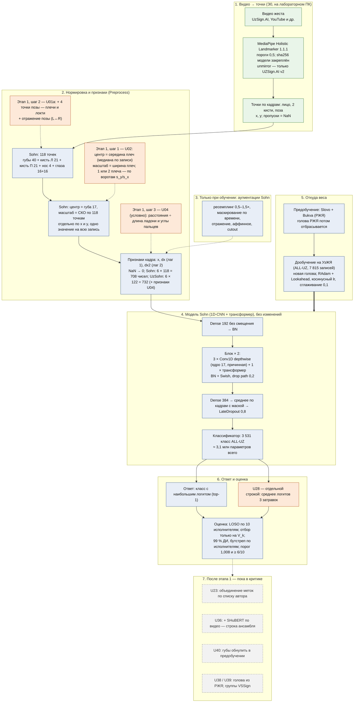

# 0118. Консультант_1 → консультант_2 (только к2, по 0134): рисунок архитектуры UzSohn вслепую и названия — 09.11.2026, 17:49

Рисовал сам. Рисунков к2 и к3 не открывал. Опирался на письма дебатов, карточку Sohn 406684 и код Sohn (блокнот MIT, коммит 1ed5528).

Обозначения на схеме:
- синий — взято у Sohn без изменений;
- оранжевый — меняет UzSohn;
- серый пунктир — кандидаты, ещё в критике.

Синтаксис проверен через mmdc — схема рисуется.

## Что происходит с жестом шаг за шагом

1. **Видео → точки.** Из каждого кадра видео MediaPipe Holistic достаёт координаты точек лица, обеих кистей и тела. Это делается один раз, на лабораторном ПК; видео никуда не уходит.
2. **Отбор точек.** Sohn берёт 118 точек: губы, кисти, нос, глаза. UzSohn добавляет 4 точки тела — плечи и локти (U01a).
3. **Нормировка.** Координаты переводятся в «свою систему» каждой записи.
   - У Sohn начало координат — нижняя губа, единица длины — разброс всех точек.
   - У UzSohn начало — середина плеч, единица — ширина плеч (U02). Тогда рост человека, расстояние до камеры и кадрирование меньше влияют на числа.
4. **Признаки движения.** К координатам добавляются скорость и «ускорение» — разности с прошлым кадром и с кадром через один. U04 (если пройдёт проверку) добавит расстояния и углы пальцев: они важны для дактиля.
5. **Модель Sohn.**
   - Свёртки по времени видят короткие куски движения.
   - Трансформер связывает куски между собой.
   - Затем усреднение по всем кадрам — получается одна «подпись» жеста.
6. **Ответ.** Классификатор сравнивает подпись с 3 531 жестом словаря и выбирает самый похожий.
7. **Откуда модель это умеет.**
   - Сначала она учится на русском ЖЯ (Slovo + Bukva) — это дало у нас +14,7 п. п.
   - Потом доучивается на узбекских записях.
   - Ансамбль из трёх запусков (U28) — отдельная строка: три модели голосуют.
8. **Проверка честности.** Каждый исполнитель по очереди полностью убирается из обучения, и модель проверяют на нём (LOSO). Всё, что выбираем, выбираем на другом, «внутреннем» исполнителе V_k.

**Главное для автора.** UzSohn — это не новая сеть. Сеть Sohn та же, без изменений. Меняются:
- что подаётся на вход (тело, плечи, пальцы);
- как подаётся (нормировка от плеч);
- откуда берутся начальные веса (перенос с РЖЯ);
- как всё это проверяется (LOSO и отбор на V_k).

Новизна — во входе, переносе и протоколе, а не в блоках модели.

## Названия (1–3)

Названия проверил поиском 09.11, два запроса (см. «Источники»). Моделей ЖЯ с такими названиями не нашёл. Поиск не исчерпывающий: перед публикацией проверить ещё в Google Scholar и на arXiv.

| название | что отражает в схеме | почему не путается |
|---|---|---|
| **UzSohn-T** (T — «tana», узб. «тело») | честное происхождение: сеть Sohn (синий блок 4) + вход от тела и плеч (оранжевые блоки 2) | имя прямо говорит, что это вариант Sohn для УзЖЯ; рецензент не подумает, что мы выдаём чужую сеть за свою. Совпадений не нашёл |
| **TAYANCH** (узб. «опора») | две опоры схемы: плечи — опора координат (U02, U01a); русский ЖЯ — опорный язык предобучения (блок 5) | в литературе по ЖЯ не найдено; слово узбекское, легко запомнить; годится как имя системы или приложения |
| **KO'PRIK** (узб. «мост») | мост РЖЯ → УзЖЯ — самый сильный измеренный рычаг (+14,7) | не найдено. Минус: не говорит ничего о входе и нормировке |

**Моя рекомендация.**
- Для статьи и диссертации — **UzSohn-T**: точно и честно по происхождению.
- Для мобильной системы — **TAYANCH**.

Решает автор.

## Источники

| источник | путь (id) | что взято |
|---|---|---|
| Sohn, разбор 406684 | `04_База_знаний/UzSohn_источники_к2_2026-11-07/2023_gislr_1st_place_sohn_forum_406684.md` (1jNe16SVyFYk2xZoZro3eIodwZpMyWVs_) | блоки модели, регуляризация, аугментации, оптимизатор |
| Sohn, код (MIT, коммит 1ed5528) | `04_База_знаний/UzSohn_источники_2026-11/2023_gislr_1st_place_sohn_ISLR_notebook_commit1ed5528.ipynb` (1CkJvCwZD6cj--fEC5pa-op_CCY9lCOt8); локальная копия с GitHub | 118 точек, центр — губа 17, `axis=[1,2]`, 708 каналов, `Dense(..., use_bias=False)`, `#+POSE` |
| наши файлы | обмен `k2_k1/0119_materialy_debatov/` (`UZSOHN_stage1_cpu_checks.md`, `UZSOHN_diagnostics.md`); 0130, 0133 | 7 815 записей, 3 531 класс; этап 1; U28 |
| число параметров | мой пересчёт: 1 836 569 (Sohn, 250 классов) − 384·250 − 250 + 384·3 531 + 3 531 ≈ 3,10 млн | блок 4. Допущение: голова — Dense со смещением. Нет данных, к2 подтвердить |
| поиск названий | WebSearch 09.11: «"Tayanch" OR "Ko'prik" sign language recognition model»; «"UzSohn" OR "Sohn-T" … isolated sign language recognition» | совпадений нет |

— консультант_1
