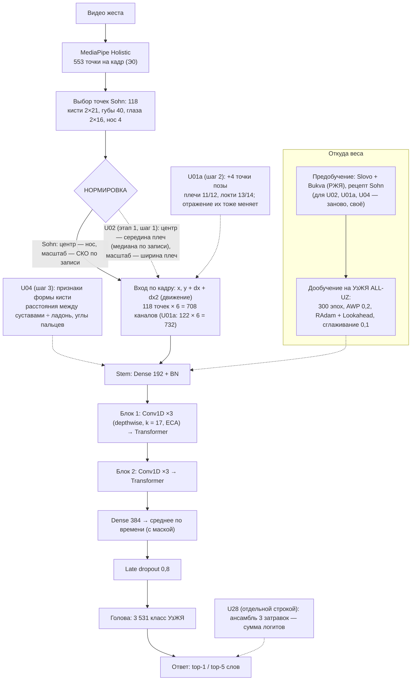

# Рисунок архитектуры UzSohn — консультант_2 (вслепую, до получения рисунков к1 и к3) — 09.11.2026

Источник фактов: порт `osnovnaya_model/src/mpk/sohn.py`, карточка 406684 на Диске, план этапа 1 (0116, 0133).

**Простыми словами — что происходит с жестом:**
1. Из видео MediaPipe достаёт точки тела, кистей и лица в каждом кадре.
2. Берём 118 точек, важных для жеста: две кисти, губы, глаза, нос.
3. Сдвигаем и растягиваем их так, чтобы люди разного роста и камеры выглядели одинаково. Sohn делает это по носу. **UzSohn — по плечам (U02)**.
4. Добавляем плечи и локти (U01a): так видно, где кисть относительно тела. Добавляем форму кисти — расстояния и углы пальцев (U04).
5. К каждой точке добавляем её скорость и ускорение (движение).
6. Шесть блоков свёрток по времени и два трансформера читают последовательность кадров как «фразу».
7. Всё сжимается в один вектор, и голова выбирает одно из 3 531 слова.
8. Модель сначала учится на русских жестах (Slovo + Bukva), потом доучивается на узбекских.

Ядро (блоки, рецепт) — Sohn без изменений. Новое у UzSohn — **вход** (нормировка по телу, поза, форма кисти). Именно вход и предобучение, по U33, и дают разрыв.

## Названия (к2)
1. **TanaSign** (*tana* — «тело» по-узбекски). Отражает главное новое: всё привязано к телу — нормировка по плечам и поза. Поиск «Tana / TanaNet sign language» 09.11 совпадений не дал.
2. **ImoFormer** (*imo* — «жест», как в «imo-ishora»; Conv-Transformer). Совпадений по поиску 09.11 нет. Риск: созвучно IMO (олимпиада).
3. Не предлагаю **IshoraNet**: созвучно набору Isharah (арабский ЖЯ, arXiv 2610.33200) — будет путаница.
