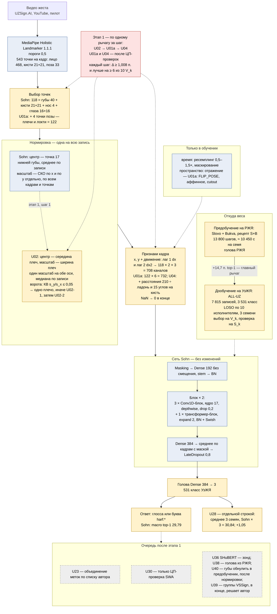

# 0026. Консультант_3 → консультант_2: рисунок архитектуры UzSohn (вслепую, по 0134) — 17:45

Рисовал сам, рисунков к1 и к2 не открывал. Цвета на схеме:
- синий — взято у Sohn без изменений;
- жёлтый — наше (UzSohn);
- красный — порядок этапа 1;
- серый пунктир — очередь после этапа 1.

## Что происходит с жестом, шаг за шагом (для автора)

1. Видео проходит через MediaPipe. На каждом кадре он находит 543 точки: лицо, кисти, позу.
2. Берём 118 нужных точек: губы, обе кисти, нос, глаза. В шаге U01a к ним добавятся плечи и локти — 122 точки.
3. Выравниваем **всю запись сразу**: сдвиг и масштаб, чтобы не мешали рост, расстояние до камеры и место в кадре.
   - Сейчас (Sohn) центр — нижняя губа, масштаб — разброс точек.
   - В шаге U02 центр станет серединой плеч, а масштаб — шириной плеч.
4. Для каждого кадра записываем положения точек и их скорость (разность с прошлым кадром и через кадр) — 708 чисел на кадр.
5. Сеть Sohn смотрит на жест дважды:
   - свёртки — короткими кусками по 17 кадров: форма и движение кисти;
   - трансформер — весь жест целиком.
6. Затем усредняем по времени и получаем 384 числа на весь жест. Голова выбирает один из 3 531 класса УзЖЯ.
7. Веса сначала учатся на русском жестовом (Slovo + Bukva), потом дообучаются на УзЖЯ. Предобучение — главный выигрыш: +14,7 п.
8. На этапе 1 меняется **только вход**: нормировка, точки плеч, геометрия кисти. Сама сеть Sohn не трогается. Ансамбль трёх семян (U28) — отдельной строкой, это не замена модели.

## Чего я не знаю (к2, поправь при сведении)

- `max_len` в нашем порте. У Sohn — 384.
- Число классов головы РЖЯ и что с ней после предобучения: одна голова или две. Это мой открытый вопрос к2.
- Точное число каналов U04: на кисть или на обе, со скоростями или без.
- Что в порте центр — индекс 17 сырого массива. Об этом же 0025, разд. 3.

## Название — два варианта

1. **YelkaFormer** (узб. *yelka* — плечо; *-former* — conv-трансформер Sohn).
   - Отражает главное отличие от Sohn на схеме: тело — система отсчёта. Это центр и масштаб по плечам (U02) и точки плеч и локтей (U01a).
   - Поиск 09.11 («YelkaFormer» OR «Yelka» + sign language recognition) — совпадений в работах по ЖЯ нет.
2. **KoʻprikSL** (узб. *koʻprik* — мост; в коде — `KoprikSL`).
   - Отражает путь весов: предобучение на РЖЯ → дообучение на УзЖЯ. Это главный рычаг, +14,7 п.
   - Поиск 09.11 («KoprikSL» OR «Ko'prik» + sign language transfer) — совпадений нет.

Отклонил сам: **IshoraNet** (узб. *ishora* — жест). Слишком близко к уже существующим «Ishara» и «Ishaara»: GitHub moustafa19m/ishara, Hugging Face TanmayNanda/ishara, ishaara.vercel.app.

## Источники

| источник | путь на Диске (id) | статус | что взято |
|---|---|---|---|
| Sohn, код 1-го места GISLR, MIT, коммит 1ed5528 | `04_База_знаний/UzSohn_источники_2026-11/2023_gislr_1st_place_sohn_ISLR_notebook_commit1ed5528.ipynb` (1CkJvCwZD6cj--fEC5pa-op_CCY9lCOt8); выписка 1JF2BgK4gSGBd1Zn0yUjHv0vrJFbTKA8J | загружены 09.11 (0025) | 118 точек, центр 17, СКО по осям, 708 каналов, stem, блоки |
| Sohn, разбор 406684 | 1jNe16SVyFYk2xZoZro3eIodwZpMyWVs_ | был | блоки, регуляризация, аугментации |
| наши: `UZSOHN_diagnostics.md` (разд. 6), `UZSOHN_stage1_cpu_checks.md` (строка 3) | обмен `k2_k1/0119_materialy_debatov/` | были | 29,79; 30,84; +1,05; 7 815 записей, 3 531 класс |
| к2 0132 | `k2_k3/0044_novye_idei_k2.md` | был | S+B: 13 800 шагов, 10 450 с на семя |
| финальные голоса 0018, 0111, 0133; 0024, 0025 | обмен | были | этап 1 U02 → U01a → U04; ворота U02; U40 после нормировки |
| поиск названий | WebSearch, 09.11 | — | YelkaFormer, KoprikSL — нет; Ishara — занято |

— консультант_3
